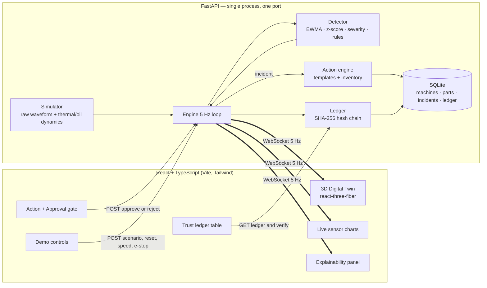

# 🛡️ Rakshak AI

### Everyone predicts. Nobody orchestrates trusted action.

<p align="left">
  
  
  
  
</p>

> Submitted to **Tata Technologies InnoVent** (POC round).
> **This is a simulation-driven proof of concept.** Sensor data is simulated. Detection, classification and
> explanations are *real computations* on that data using documented rules. No trained-model accuracy, user
> counts or benchmark numbers are claimed anywhere in this repository or the UI.

Rakshak AI is an explainable predictive-maintenance and **trusted-action** layer for Indian heavy machinery. It closes the
loop that most predictive-maintenance tools leave open:

```
Fault prediction → Explainability → Workflow orchestration → Human approval → Trust ledger
```

The prototype's centrepiece is a **live 3D digital twin** of a conveyor drive (motor → gearbox → Bearing #3 → drive
pulley). The twin reflects machine health in real time. A simulated sensor stream feeds a real detection loop, and every
decision ends in an auditable, human-approved action.

---

## 1. Why

Indian sites (mining, cement, construction, ports) already get predictive-maintenance *alerts*. The alerts are widely ignored
because they are low-context ("anomaly score 0.83"), they cannot be traced to a physical cause, and they never turn into an
accountable action. Prediction value leaks away in the gap between **alert** and **trusted, executed action**. That gap is
what Rakshak AI targets. (Problem framing, competition and roadmap: [`docs/`](docs/).)

## 2. What the prototype does (end-to-end, live)

| Step | What happens | Where |
|---|---|---|
| **1. Live sensors** | Simulated vibration (mm/s RMS, computed from a raw 2 kHz waveform), housing temperature (°C), lube-oil pressure (bar) and oil-quality index stream over WebSocket at 5 Hz, with realistic noise. | `backend/rakshak/simulator.py` |
| **2. Anomaly detection** | EWMA smoothing → z-score against a **commissioning baseline** learned from 60 healthy windows → per-signal severity (0 inside ±3σ, 1 at the trip limit) → anomaly score = 1 − Π(1 − severity). The score on screen is this computed value. | `backend/rakshak/detection.py` |
| **3. Fault classification** | Explicit IF-THEN rules: *high vibration + kurtosis ≥ 4 → bearing defect*; *temperature rise with normal oil pressure → overheating*; *oil-pressure drop or oil degradation → lubrication fault*. Risk = Low / Medium / Critical from the score, with alarm/trip-limit overrides. | same |
| **4. Explainability** | Ranked feature contributions in plain language, e.g. *"Lube-oil pressure down 25% from baseline (2.26 bar vs 3.00 bar, −26.7σ) — dominant factor"*. **Labelled in the UI as rule/feature-contribution based, not SHAP.** | same |
| **5. Trusted Action Engine** | Fault → structured action from a reviewed template (steps, est. hours, technician count, skills, priority window) + **inventory check** against the seeded parts table (shortfalls and reorder flags). | `backend/rakshak/actions.py` |
| **6. Human approval gate** | Nothing is executed until a named engineer **approves**. Approval dispatches a work order, reserves stock and starts a controlled shutdown. **Reject** requires a reason; the same fault is re-raised only if risk escalates. | `backend/rakshak/engine.py` |
| **7. Trust ledger** | Append-only, timestamped events (fault → explanation → action → approval → outcome). Each entry stores the SHA-256 of its predecessor; SQLite triggers reject UPDATE/DELETE; `GET /api/ledger/verify` recomputes the chain. Persisted across refreshes and restarts. | `backend/rakshak/ledger.py` |
| **8. Outcome verification** | After the simulated repair, the detector must see LOW risk for 10 consecutive windows before the incident is closed as **resolved**, with the measured post-repair score. | `backend/rakshak/engine.py` |

**Actual output of the prototype on simulated data** (copied from the trust ledger):

> `FAULT_DETECTED` Lubrication fault (oil starvation) on Gearbox lubrication system — risk MEDIUM, anomaly score 0.63
> `EXPLANATION_GENERATED` Top driver: Lube-oil pressure down 25% from baseline (2.26 bar vs 3.00 bar, −26.7σ) — dominant factor (58% of deviation)
> `ACTION_PROPOSED` Restore gearbox lubrication: filter change, flush & refill · 2.5 h · 2 technicians · parts available — awaiting human approval
> `HUMAN_APPROVED` A. Kumar (Shift Engineer) → `WORK_ORDER_DISPATCHED` → `MAINTENANCE_COMPLETED` → `OUTCOME_VERIFIED` post-repair anomaly score 0.01

### The 3D digital twin
- Built **entirely from Three.js primitives** (no external models or HDRIs), so it loads offline and behind strict CSPs.
- **Healthy:** cool palette, steady rotation, ore moving on the belt.
- **Warning:** amber emissive glow on the affected component and a slight shake.
- **Critical:** red pulsing glow, a red alert light, a floor halo and stronger shake on the faulted part (e.g. **Bearing #3**).
- **E-Stop** coasts the drive to a standstill. During approved maintenance the component turns blue and is labelled *LOTO · REPAIR*.
- Live data drives the visuals directly: shake amplitude comes from the measured vibration RMS, the gauge needle shows lube-oil pressure, and the oil sight-glass colour follows oil quality.
- The twin only highlights a component the **detector** localised. It never sees which fault was injected.
- Orbit controls, grid floor and contact shadows; respects `prefers-reduced-motion` (no shake or pulse).

## 3. Architecture



**Repository layout**

```
backend/
  app.py                 FastAPI app: REST + WebSocket + serves frontend/dist
  legacy_predict.py      original IsolationForest /predict endpoint (not used by the twin loop)
  rakshak/
    simulator.py         simulated conveyor drive (raw vibration waveform, thermal & lube dynamics)
    detection.py         baseline, EWMA, severity, anomaly score, risk, fault rules, contributions
    actions.py           action templates + inventory check / reservation
    ledger.py            append-only hash-chained trust ledger
    engine.py            tick loop + incident lifecycle + controls + broadcasting
    db.py / seed.py      SQLite schema (with append-only triggers) and seed data
    schemas.py           typed API contracts (mirrored in frontend/src/types.ts)
  tests/                 pytest: detection math, rules, ledger integrity, full lifecycle over HTTP/WS
frontend/
  src/twin/              procedural 3D conveyor drive + state mapping
  src/components/        status, sensor cards, explainability, action/approval, ledger, controls
  src/hooks/             WebSocket telemetry with auto-reconnect, reduced-motion
  src/test/              Vitest + Testing Library component tests
models/, notebooks/      earlier synthetic-data IsolationForest baseline + EDA
docs/                    architecture, workflow, competitive analysis, FAQ, roadmap
```

### API

| Method | Path | Purpose |
|---|---|---|
| WS | `/ws/telemetry` | 5 Hz frames: readings, raw waveform, detection, current incident, ledger head |
| GET | `/api/state` | machine, baseline stats, speeds, latest frame |
| POST | `/api/sim/scenario` `{scenario}` | inject a simulated `bearing` / `overheating` / `lubrication` fault |
| POST | `/api/sim/reset` · `/api/sim/speed` `{speed}` · `/api/sim/estop` `{actor}` | demo controls |
| GET | `/api/incidents` · `/api/incidents/{id}` | incidents with frozen explanation + action |
| POST | `/api/incidents/{id}/approve` `{approver, note}` | human approval → work order, parts, shutdown |
| POST | `/api/incidents/{id}/reject` `{approver, reason}` | human rejection (reason required) |
| GET | `/api/ledger` · `/api/ledger/verify` | audit trail · recompute hash chain |
| GET | `/api/inventory` · `/health` · `/docs` | parts table · liveness · OpenAPI UI |

Demo-control actions are written to the ledger tagged `simulation-control`, and seed entries are tagged `seed-sample`. The
UI shows both tags, so the audit trail never passes simulation or sample data off as real events.

## 4. Run it

### One command, single container (production mode)
```bash
docker compose up --build        # → http://localhost:8000  (UI, API, WebSocket on one port)
```
or `docker build -t rakshak-ai . && docker run -p 8000:8000 -v rakshak-data:/data rakshak-ai`.
The ledger lives in the `/data` volume and survives container restarts. If Docker Hub rate-limits you, point the base
images at a mirror: `--build-arg NODE_IMAGE=mirror.gcr.io/library/node:22-alpine --build-arg PYTHON_IMAGE=mirror.gcr.io/library/python:3.12-slim`.

**Render:** connect the repo; `render.yaml` defines a Docker web service with a 1 GB disk at `/data`. Without a disk,
Render's filesystem is ephemeral: the ledger survives refreshes and restarts but not redeploys.

### One command, dev mode (hot reload)
```bash
make dev            # or ./scripts/dev.sh  → http://localhost:5173 (Vite proxies /api and /ws to :8000)
```
Requires Python 3.10+ and Node 20+. The script creates `.venv`, installs dependencies and starts both servers.

### Tests
```bash
make test           # pytest (backend) + vitest & tsc (frontend)
```

### Configuration
Copy `.env.example` → `.env`. Every setting is optional: DB path, tick rate, simulator seed, CORS origins, port.

### Before a live demo
```bash
make reseed         # stop the server first; fresh DB: full parts stock, clean ledger (3 labelled sample entries)
```
Each approved repair consumes stock, so repeated rehearsals will eventually show real **shortfalls**. That is correct
behaviour, but reseed before the judged run.

## 5. Three-minute demo script

| Time | Do | Say |
|---|---|---|
| 0:00 | App is open: twin running, charts live, **LOW RISK**. Orbit the twin once. | "This is conveyor drive CD-07 as a live digital twin. The amber badge says it plainly: data is simulated, but everything downstream is real computation." |
| 0:20 | Point at the sensor cards and the raw vibration window. | "Vibration RMS and kurtosis are computed from a raw waveform every 200 ms and compared against a baseline the system learned at commissioning." |
| 0:35 | Click **Simulate → Bearing fault**. | "I'm injecting a bearing defect into the *sensor stream*. The detector doesn't know what I injected." |
| 0:40 | Twin: **Bearing #3 glows red**, shakes; score jumps; banner appears. | "Within a second the score rises, the rule *vibration high AND kurtosis ≥ 4* fires, and the twin localises Bearing #3." |
| 0:55 | Explainability panel. | "Why? Vibration is 4.9× baseline and impulsive. This is a rule-based contribution breakdown, not SHAP, and we label it that way." |
| 1:15 | Click **Review action**. Show steps, 3.5 h, 2 technicians, inventory **all in stock**. | "Everyone predicts. We orchestrate: a structured action, crew size, and a live stock check against the stores table." |
| 1:35 | Point at the **lock**. Type your name → **Approve action**. | "Nothing happens until a named human approves. No shutdown, no parts, no work order." |
| 1:45 | Twin turns blue (*LOTO · REPAIR*), rotation stops; stepper moves to Execute → Verify. | "Approval dispatched the work order, reserved the bearing and triggered a controlled shutdown." |
| 2:05 | Machine restarts; **Outcome verified**, post-repair score ≈ 0. | "We don't assume the fix worked. We verify it: ten clean windows before closing." |
| 2:20 | Scroll to **Trust ledger** → **Verify hash chain**. Expand one row. | "Every step is in an append-only, SHA-256-chained ledger. Edits are blocked, and tampering is detectable. Refresh: it's still here." |
| 2:40 | Optional: **Lubrication fault** → **Reject** with a reason. | "Engineers can say no. The rejection and its reason are recorded, and we only re-alert if risk escalates." |
| 2:55 | Close. | "Prediction → explanation → action → human approval → audit trail. That's the trust loop." |

Fallbacks: **Reset to healthy** recovers from any state; the **2×/4×** speed control shortens waits; if WebGL fails, the
twin panel shows a notice and the rest of the dashboard keeps working.

## 6. Prototype photos: what to screenshot

1. **Healthy hero**: full dashboard at 1600×1000, dark theme, LOW RISK, live charts (shows the "realistic working state").
2. **Critical bearing fault**: Bearing #3 glowing red with the floor halo and *BRG #3 · CRITICAL* label, risk pill CRITICAL, anomaly score.
3. **Explainability close-up**: ranked contributions with plain-language text and the *Rule-based · not SHAP* tag.
4. **Approval gate**: proposed action, crew/time/priority, inventory check and the locked Approve / Reject controls.
5. **Maintenance in progress**: twin component in blue *LOTO · REPAIR*, stepper at Execute, work-order number.
6. **Verified outcome**: stepper fully complete, *Outcome verified* with the post-repair score.
7. **Trust ledger**: full incident chain (FAULT_DETECTED → … → OUTCOME_VERIFIED) with *Chain intact* after **Verify hash chain**, one row expanded to show hashes + payload.
8. **Rejection path**: a rejected incident with the engineer's reason in the ledger.
9. **Light theme / tablet width**: shows responsiveness and theme tokens.
10. **Footer disclaimer**: the "Simulation-driven proof of concept" statement, to show the integrity stance.

## 7. What's built vs. what's designed next

| Built and working now | Designed next (not built) |
|---|---|
| Live 3D digital twin reflecting computed health state | **Trained ML model** on real bearing datasets (CWRU, NASA IMS/PRONOSTIA), with evaluation reported honestly |
| Simulated multi-sensor stream (raw vibration waveform → RMS/kurtosis/crest; temperature; oil pressure; oil quality) | **SHAP** attributions on that model, replacing the rule-based contributions |
| Real detection: commissioning baseline, EWMA, z-scores, limit-based severity, anomaly score | **Trust Index**: blend model confidence with historical precedent and technician feedback |
| Rule-based fault classification (bearing / overheating / lubrication) with risk levels | **Real IoT ingestion** (MQTT / OPC-UA gateways, OEM-agnostic normalised schema, offline buffering) |
| Plain-language, ranked feature-contribution explanations | **Multi-machine fleet view** and per-site dashboards |
| Action templates with inventory check, reservation, shortfall & reorder flags | CMMS/ERP integration (e.g. SAP PM work orders), technician mobile app, regional-language alerts |
| Human approval gate (approve / reject-with-reason, re-alert on escalation) | Role-based access & e-signatures on approvals |
| Append-only, hash-chained trust ledger in SQLite with verification endpoint | Feedback loop (confirmed fault / false alarm) feeding rule and model tuning |
| Outcome verification after repair | Remaining-useful-life (RUL) estimation |
| Single-container deploy (Docker / Render), seed script, 37 backend + 19 frontend tests | |

The earlier synthetic-data **IsolationForest baseline** (`models/`, `notebooks/`) is kept and still served at
`POST /predict` (install `requirements-ml.txt`). It is *not* part of the twin loop, and no accuracy is claimed for it.

## 8. Integrity notes (for technical Q&A)

- **Where does "94%" come from?** Nowhere. The anomaly score is `1 − Π(1 − sᵢ)` over five per-signal severities, computed every 200 ms. You can see every input in the sensor cards and in the ledger payloads.
- **Are the limits real?** The vibration zones are modelled on ISO 10816-3 (group 2, flexible foundation: 2.3 / 4.5 / 7.1 mm/s). The other limits are engineering heuristics for this simulated machine, kept in one table in `detection.py`.
- **Is the ledger a blockchain?** No. It is a tamper-evident hash chain inside one SQLite database, plus triggers that block edits. Tampering via raw file access is *detected* by `/api/ledger/verify` (see `test_verify_detects_tampering`).
- **Is anything pre-recorded?** No. The simulator is seeded for reproducibility, but every frame is generated and analysed live.

## 9. Team

| Name | Role |
|---|---|
| _Your Name_ | Founder / Concept, ML & Backend |

*(Update with real names/roles before submission.)*

---

<p align="center"><i>Built for the InnoVent challenge. Documented honestly: what's working, what's designed, and what's still ahead.</i></p>
