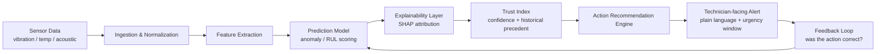

# 🛡️ Rakshak AI

### Beyond Alerts: Turning Machine Predictions into Trusted Actions for Indian Heavy Machinery

<p align="left">
  
  
  
  
  
</p>

> Submitted to **Tata Technologies InnoVent**.
> This repository is the engineering counterpart to the Rakshak AI pitch deck — it documents the architecture, reasoning, and current implementation state honestly, including what is **not yet built**.

---

## 1. The Problem

Heavy machinery in India — cranes, excavators, compressors, mining haul equipment — increasingly ships with IoT sensors and OEM dashboards that generate **predictive maintenance alerts**. In practice, these alerts are widely ignored on the ground because:

- **Alert fatigue.** Dashboards fire frequent, low-context warnings ("vibration anomaly detected") with no explanation of *why* or *what to do next*.
- **No trust, no action.** A site technician with 15 years of hands-on experience will not shut down a ₹2 crore excavator because a model says "anomaly score: 0.83." There is no traceability from prediction to physical cause.
- **Fragmented fleets.** A typical Indian construction or mining site runs equipment from multiple OEMs (L&T, Tata Hitachi, Caterpillar, JCB), each with its own proprietary alerting silo. There is no unified, explainable layer across them.
- **Connectivity & skill gaps.** Many sites have intermittent connectivity and maintenance teams without data-science backgrounds, so alerts must degrade gracefully and explain themselves in plain, actionable language.

The result: predictive maintenance systems exist, but the gap between **prediction** and **trusted, executed action** is where the value is lost.

## 2. The Solution

**Rakshak AI** is a decision-support layer that sits between raw sensor predictions and the maintenance team, with one job: make every alert **explainable, trustworthy, and actionable**.

Instead of "Anomaly Detected," Rakshak AI aims to produce:

> ⚠️ **Bearing wear suspected — Excavator EX-104, rear axle.**
> Confidence: 81% · Primary driver: rising high-frequency vibration (4.2 kHz band) over 6 days.
> Similar pattern preceded 3 of 4 historical bearing failures in this fleet.
> **Recommended action:** Schedule inspection within 72 hours. Estimated downtime if ignored: 2–4 days.

## 3. Core Innovations

| # | Innovation | Why it matters |
|---|---|---|
| 1 | **Explainability-first scoring** (SHAP-based) | Every prediction ships with the top contributing signals, not just a score. |
| 2 | **Trust Index** | A secondary confidence layer that blends model confidence with historical precedent (has this pattern caused failures before?), so technicians know *how much* to trust an alert. |
| 3 | **Action Recommendation Engine** | Converts a prediction into a concrete next step (inspect / monitor / schedule downtime) with an estimated urgency window, not just a flag. |
| 4 | **OEM-agnostic ingestion** | Designed around a normalized sensor schema so it can sit across multiple equipment brands instead of being locked to one OEM's telemetry format. |
| 5 | **Designed for Indian field conditions** | Plain-language output, graceful degradation on poor connectivity, and no assumption that the end user is a data scientist. |

## 4. Workflow



The feedback loop (I → D) is the part most predictive-maintenance pitches skip. Rakshak AI treats technician feedback (confirmed fault / false alarm) as a labeled signal that should retrain the Trust Index over time — this is currently designed but **not yet implemented** (see [Current Status](#6-current-status)).

## 5. Technology Stack

| Layer | Choice | Status |
|---|---|---|
| Backend API | FastAPI (Python) | ✅ Scaffolded, working endpoint |
| Modeling | scikit-learn (IsolationForest baseline), SHAP for explainability | ✅ Baseline trained on synthetic + planned CWRU data |
| Data | CWRU Bearing Dataset, MIMII acoustic dataset, synthetic vibration generator | 🔶 Synthetic in use now; real datasets planned (see [datasets/](datasets/)) |
| Frontend | React | 🔶 Not yet started — planned Phase 5 |
| Notebooks / EDA | Jupyter, pandas, matplotlib | ✅ One working EDA notebook |
| Testing | pytest | ✅ Basic API test |
| Deployment target | Containerized FastAPI service (Docker — planned) | 🔶 Planned |

Full detail in [docs/TechStack.md](docs/TechStack.md).

## 6. Current Status

**Honest assessment — this is a Concept Validation / Early Prototype, not a production system.**

| Component | State |
|---|---|
| Problem framing & architecture | ✅ Defined |
| Synthetic vibration data + EDA | ✅ Working notebook |
| Baseline anomaly detection model | ✅ Trained (IsolationForest on synthetic data) |
| SHAP explainability | 🔶 Planned, not yet wired into the API |
| FastAPI backend | ✅ Health check + single prediction endpoint working |
| Trust Index | 🔶 Designed conceptually, not implemented |
| Action Recommendation Engine | 🔶 Designed conceptually, not implemented |
| Frontend dashboard | ❌ Not started |
| Real-world dataset (CWRU/MIMII) integration | 🔶 Planned for Phase 2 |

## 7. Future Roadmap

See [docs/FutureRoadmap.md](docs/FutureRoadmap.md) for the full phased plan. Short version:

1. Replace synthetic data with CWRU + MIMII real datasets.
2. Wire SHAP explainability into the live API response.
3. Build the Trust Index using historical-precedent weighting.
4. Build the Action Recommendation Engine as a rules + ML hybrid.
5. Build a minimal React dashboard consuming the API.
6. Pilot with one real machine class (target: rotating equipment / bearings, the best-instrumented failure mode in industry).

## 8. Folder Structure

```
rakshak-ai/
├── README.md                  # This file
├── LICENSE
├── requirements.txt
├── docs/                      # Engineering documentation (architecture, workflow, competitive analysis, FAQ, roadmap)
├── presentation/               # Pitch deck + InnoVent submission materials
├── assets/                     # Diagrams, screenshots, supporting images
├── datasets/                   # Dataset notes + synthetic data generator (no large binary data checked in)
├── notebooks/                  # EDA and model exploration notebooks
├── models/                     # Model training scripts + saved baseline model
├── backend/                    # FastAPI service (prediction API)
│   └── tests/                  # API tests
```

## 9. Team

| Name | Role |
|---|---|
| _Your Name_ | Founder / Concept, ML & Backend |

*(Update with real names/roles before submission — judges weight team credibility heavily.)*

---

<p align="center"><i>Built for the InnoVent challenge. Documented honestly: what's working, what's designed, and what's still ahead.</i></p>
